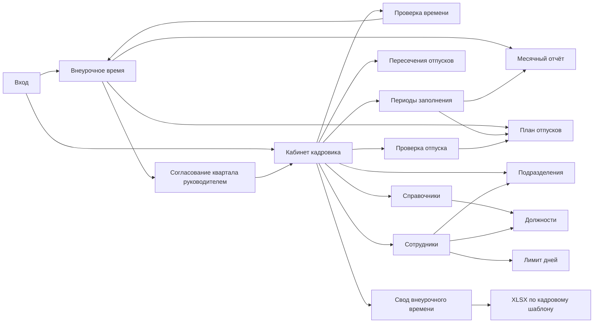
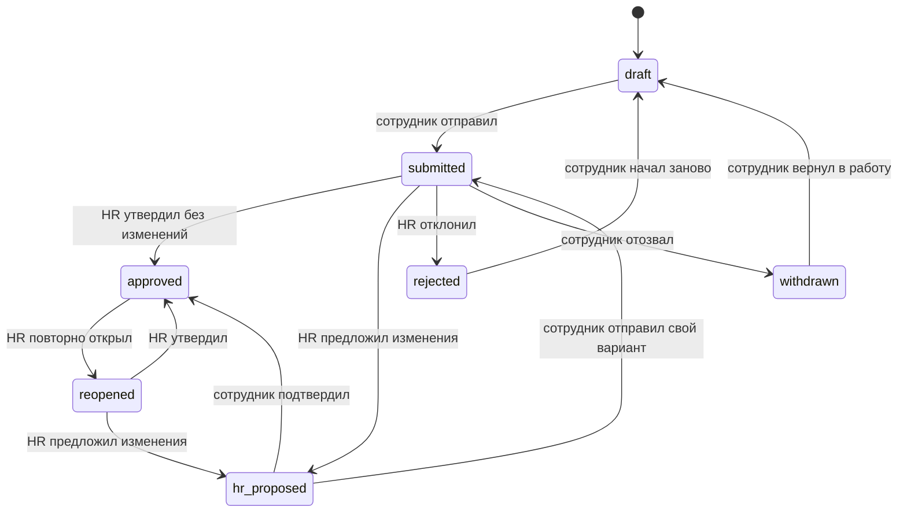

# Карта продукта TFOMS Time

Этот документ — реестр пользовательских действий и связей между интерфейсом, API, данными и правами. Если действие отсутствует здесь или не имеет реального серверного пути, его нельзя показывать в продукте как рабочее.

Обозначения: `готово` — есть UI, серверное право, постоянное хранение и проверка; `частично` — основной путь работает, но отсутствует важная операция; `не реализовано` — только roadmap, без элемента в UI.

## Навигационная карта

## Матрица ролей и областей

| Область                      | Сотрудник                                             | Руководитель подразделения                       | Кадровик                                                    | Руководитель кадров | Состояние                |
| ---------------------------- | ----------------------------------------------------- | ------------------------------------------------ | ----------------------------------------------------------- | ------------------- | ------------------------ |
| Собственное внеурочное время | создание, правка черновика, отправка, ответ на правку | собственный отчёт                                | проверка, утверждение, предложение изменений                | то же               | готово                   |
| Квартал подразделения        | нет                                                   | комплектность, чтение отчётов, «Согласовано»     | получает только согласованные кварталы                      | вся организация     | готово                   |
| Собственный план отпусков    | создание периодов, отправка, ответ на правку          | как сотрудник                                    | проверка, утверждение, предложение изменений                | то же               | готово                   |
| Очередь решений              | нет                                                   | нет                                              | записи, где требуется действие HR                           | вся организация     | готово                   |
| Пересечения отпусков         | нет                                                   | нет                                              | просмотр по подразделениям                                  | вся организация     | готово, фильтры частично |
| Сотрудники                   | нет                                                   | нет                                              | создание, назначение, лимиты, блокировка, сброс пароля      | то же + HR-роли     | частично                 |
| Подразделения                | нет                                                   | собственная область согласования                 | иерархия, руководитель, согласующий, создание и отключение  | то же               | готово                   |
| Должности                    | нет                                                   | нет                                              | CRUD и норматив дней за ненормированный день                | то же               | готово                   |
| Периоды заполнения           | подчиняется открытому окну                            | видит отправленные данные                        | открыть / закрыть год отпусков и месяцы внеурочного времени | то же               | готово                   |
| Свод и Excel                 | нет                                                   | состояние четырёх кварталов своего подразделения | нормативы, индивидуальные значения, кварталы, итоги и XLSX  | вся организация     | готово                   |
| Кампания отпусков            | участие                                               | нет                                              | управление                                                  | управление          | не реализовано           |
| Уведомления                  | получение                                             | получение                                        | получение и массовые напоминания                            | настройки           | не реализовано           |

## Сотрудник: внеурочное время

| Экран / действие              | Условие                              | Результат                              | API и данные                                                | Следующий шаг                  | Состояние      |
| ----------------------------- | ------------------------------------ | -------------------------------------- | ----------------------------------------------------------- | ------------------------------ | -------------- |
| Предыдущий / следующий месяц  | авторизован                          | загружен отчёт месяца                  | `GET /api/overtime`, `overtime_reports`, `overtime_entries` | выбрать день                   | готово         |
| Выбрать день                  | дата не в будущем, отчёт редактируем | день активен                           | локальное состояние                                         | выбрать длительность           | готово         |
| 5 / 10 / 15 / 30 мин / 1 час  | выбран день                          | значение записано локально             | серверная проверка набора значений при сохранении           | сохранить / отправить          | готово         |
| Очистить                      | выбран заполненный день              | значение удалено локально              | сохраняется через `PUT /api/overtime`                       | сохранить / отправить          | готово         |
| «Внеурочного времени не было» | нет записанных дней                  | нулевой отчёт подтверждён              | `zero_confirmed`                                            | отправить                      | готово         |
| Сохранить черновик            | есть значения или подтверждён ноль   | постоянный черновик                    | `PUT /api/overtime`, ревизия                                | продолжить позже / отправить   | готово         |
| Отправить на согласование     | черновик валиден                     | `submitted`                            | `POST /api/workflow`                                        | руководитель закрывает квартал | готово         |
| Подтвердить правку HR         | `hr_proposed`                        | `approved`                             | `POST /api/workflow`                                        | завершено                      | готово         |
| Изменить снова                | `hr_proposed`                        | сотрудник редактирует встречную версию | `PUT /api/overtime`                                         | HR проверяет снова             | готово         |
| Отозвать отправленный отчёт   | `submitted`                          | `withdrawn`                            | переход разрешён доменом, кнопки нет                        | черновик                       | не реализовано |

## Сотрудник: отпуск

| Экран / действие           | Условие                     | Результат                                | API и данные                                   | Следующий шаг            | Состояние      |
| -------------------------- | --------------------------- | ---------------------------------------- | ---------------------------------------------- | ------------------------ | -------------- |
| Предыдущий / следующий год | авторизован                 | загружен план года                       | `GET /api/vacations`                           | выбрать период           | готово         |
| Выбрать начало и конец     | план редактируем            | период добавлен, первая дата видна сразу | локально + `vacation_periods` после сохранения | добавить ещё / сохранить | готово         |
| Удалить период             | план редактируем            | период удалён локально                   | `PUT /api/vacations` после сохранения          | сохранить                | готово         |
| Лимит дней                 | всегда                      | превышение блокируется                   | UI + домен + API + HR API                      | исправить периоды        | готово         |
| Сохранить черновик         | периоды валидны             | постоянный план                          | `PUT /api/vacations`                           | продолжить / отправить   | готово         |
| Отправить кадровику        | есть период, лимит соблюдён | `submitted`                              | `POST /api/workflow`                           | HR принимает решение     | готово         |
| Подтвердить правку HR      | `hr_proposed`               | `approved`                               | `POST /api/workflow`                           | завершено                | готово         |
| Изменить снова             | `hr_proposed`               | встречная версия                         | `PUT /api/vacations`                           | HR проверяет снова       | готово         |
| Отозвать отправленный план | `submitted`                 | `withdrawn`                              | переход разрешён доменом, кнопки нет           | черновик                 | не реализовано |

## Кадровик: кабинет и согласование

Кадровая очередь внеурочного времени дополнительно защищена серверным квартальным гейтом. Даже прямой URL или API-запрос не открывает отчёт, пока назначенный ответственный не согласовал соответствующий квартал.

| Экран / действие                        | Что показывает / делает                             | Серверный источник            | Следующий шаг                    | Состояние                         |
| --------------------------------------- | --------------------------------------------------- | ----------------------------- | -------------------------------- | --------------------------------- |
| «Требуют решения»                       | только `submitted` и `reopened`, где действие за HR | реальные отчёты организации   | открыть запись                   | готово                            |
| «Ждём ответа сотрудника»                | количество `hr_proposed`; это не очередь HR         | реальные отчёты организации   | ждать ответа, без ложной кнопки  | готово                            |
| Фильтры Все / Время / Отпуска           | меняют состав очереди через URL                     | серверная выборка             | открыть запись                   | готово                            |
| «Проверить время»                       | открывает конкретный отчёт                          | `/hr/overtime/:id`            | утвердить или изменить           | готово                            |
| «Проверить отпуск»                      | открывает конкретный план                           | `/hr/vacations/:id`           | утвердить или изменить           | готово                            |
| «Утвердить без изменений»               | `submitted` или `reopened` → `approved`             | `POST /api/workflow` + аудит  | завершено                        | готово                            |
| «Предложить изменения»                  | сохраняет правку HR с обязательной причиной         | HR API + ревизия + аудит      | сотрудник отвечает               | готово                            |
| Отклонить                               | `submitted` → `rejected` с причиной                 | доменный переход есть, UI нет | сотрудник создаёт новый черновик | не реализовано                    |
| Повторно открыть утверждённое           | `approved` → `reopened` с причиной                  | доменный переход есть, UI нет | новая проверка                   | не реализовано                    |
| История решения                         | события согласования                                | `approval_events`             | аудит                            | время — готово, отпуск — частично |
| Поиск, подразделение, период, просрочка | фильтрация очереди                                  | API пагинации отсутствует     | найти запись                     | не реализовано                    |
| Серверная пагинация                     | очередь более 8 записей                             | отсутствует                   | следующая страница               | не реализовано                    |

## Руководитель подразделения: квартальное согласование

| Действие                         | Проверка                                                                 | Результат                                         | Серверный путь                               | Состояние |
| -------------------------------- | ------------------------------------------------------------------------ | ------------------------------------------------- | -------------------------------------------- | --------- |
| Открыть год                      | пользователь назначен согласующим хотя бы одного активного подразделения | четыре квартала по каждому подразделению          | `/approvals`, исторические назначения        | готово    |
| Открыть месячный отчёт           | отчёт относится к назначенному подразделению                             | режим чтения без кадровых правок                  | `/approvals/overtime/:id`                    | готово    |
| Проверить комплектность квартала | для каждого месяца определяется одно подразделение по истории назначения | `готово / ожидается`, число полученных/нужных     | `overtime_reports`, `department_assignments` | готово    |
| Нажать «Согласовано»             | все ожидаемые отчёты за три месяца отправлены                            | квартал доступен кадровику и экспорту             | `POST /api/approvals/quarter`, аудит         | готово    |
| Встречная правка сотрудника      | согласованный отчёт изменён после предложения HR                         | квартал автоматически получает `reopened`         | транзакция отчёта + аудит                    | готово    |
| Изменение состава подразделения  | сотрудник добавлен/переведён/отключён внутри согласованного квартала     | согласование снимается, комплектность пересчитана | HR API сотрудников + аудит                   | готово    |

## Кадровик: свод внеурочного времени

| Действие                     | Результат                                                                  | Данные / проверка                                      | Состояние |
| ---------------------------- | -------------------------------------------------------------------------- | ------------------------------------------------------ | --------- |
| Выбрать год                  | показаны сотрудники, нормативы и состояние кварталов                       | `/hr/reporting?year=…`                                 | готово    |
| Установить максимум всем     | индивидуальный максимум записан всем активным сотрудникам                  | `PUT /api/hr/irregular-leave-terms`, аудит             | готово    |
| Настроить сотрудника         | индивидуальный максимум, фактические дни по договору, предложение на год+1 | уникальная запись сотрудник+год, ограничения 0…30      | готово    |
| Настроить норматив должности | значение используется по умолчанию, если нет индивидуального               | справочник должностей, ограничения 0…30                | готово    |
| Выгрузить Excel              | файл с подразделениями, 12 месяцами, кварталами, годом и сравнением        | только кварталы со статусом `approved`, аудит выгрузки | готово    |

## Кадровик: периоды заполнения

| Экран / действие                  | Что происходит                                                 | Серверный путь                     | Состояние |
| --------------------------------- | -------------------------------------------------------------- | ---------------------------------- | --------- |
| Предыдущий / следующий год        | загружаются реальные настройки выбранного года                 | `GET /api/hr/entry-windows?year=…` | готово    |
| Открыть / закрыть план отпусков   | меняется доступ к редактированию для всей организации на год   | `PUT /api/hr/entry-windows`, аудит | готово    |
| Открыть / закрыть месяц времени   | меняется доступ к редактированию для всей организации на месяц | `PUT /api/hr/entry-windows`, аудит | готово    |
| Редактирование сотрудником        | UI, сохранение и отправка блокируются при закрытом окне        | API отпусков / времени / workflow  | готово    |
| Проверка уже отправленных записей | кадровик продолжает проверку и после закрытия окна заполнения  | HR API и workflow                  | готово    |
| Повторная работа отправленного    | открытое окно не отменяет статус `submitted` или `approved`    | отдельные состояния согласования   | готово    |

Окно заполнения и статус документа — независимые ограничения. Открытый год или месяц разрешает сотрудникам работать с черновиками, но не превращает отправленные или утверждённые записи обратно в черновик. Закрытие окна прекращает новые правки сотрудников, не останавливая проверку кадровиком.

## Кадровик: сотрудники

| Действие                             | Ввод                                                                | Результат                                | Проверки                                                   | Состояние      |
| ------------------------------------ | ------------------------------------------------------------------- | ---------------------------------------- | ---------------------------------------------------------- | -------------- |
| Добавить сотрудника                  | ФИО, логин, временный пароль, подразделение, должность, роль, лимит | пользователь + назначение + план отпуска | уникальный логин, пароль ≥ 12, активные справочники, аудит | готово         |
| Редактировать                        | ФИО, подразделение, должность, роль, лимит                          | обновление профиля и назначения          | принадлежность организации, лимит не ниже выбранных дней   | готово         |
| Отключить / включить                 | крупный переключатель                                               | блокировка входа / восстановление        | нельзя отключить себя, сессии отзываются                   | готово         |
| Критичная должность                  | крупный переключатель                                               | влияет на пересечения отпусков           | хранение в назначении                                      | готово         |
| Сбросить пароль                      | новый временный пароль                                              | хеш заменён, сессии отозваны             | ≥ 12 символов                                              | готово         |
| Применить дни всем                   | год + число                                                         | массовое обновление лимитов              | не ниже уже выбранных дней                                 | готово         |
| Изменить дни отдельно                | карточка сотрудника                                                 | индивидуальный лимит                     | не ниже уже выбранных дней                                 | готово         |
| Обязательная смена временного пароля | первый вход                                                         | новый личный пароль                      | флага и экрана нет                                         | не реализовано |
| Поиск и фильтры штата                | ФИО, отдел, статус, должность                                       | отфильтрованный список                   | серверной пагинации нет                                    | не реализовано |
| История назначений                   | сотрудник                                                           | периоды отделов и должностей             | данные сохраняются, UI нет                                 | частично       |
| Импорт                               | кадровая выгрузка                                                   | массовое создание/обновление             | формат не согласован                                       | не реализовано |

## Кадровик: справочники

| Справочник / действие      | Результат                                            | Ограничения                           | Состояние      |
| -------------------------- | ---------------------------------------------------- | ------------------------------------- | -------------- |
| Подразделения: создать     | новый активный отдел                                 | уникальное название в организации     | готово         |
| Подразделения: изменить    | название, штат                                       | принадлежность организации            | готово         |
| Подразделения: отключить   | скрыт для новых назначений                           | нельзя при действующих назначениях    | готово         |
| Должности: создать         | новая должность для кадровых назначений              | уникальное название в организации     | готово         |
| Должности: переименовать   | название меняется во всех актуальных отображениях    | принадлежность организации            | готово         |
| Должности: отключить       | недоступна для новых назначений, история сохраняется | существующие назначения не удаляются  | готово         |
| Иерархия подразделений     | вышестоящее подразделение, защита от циклов          | ручное ведение, импорт отсутствует    | готово         |
| Руководитель подразделения | назначение сотрудника                                | получает роль и область согласования  | готово         |
| Согласующий                | по умолчанию руководитель, можно выбрать другого     | только активный сотрудник организации | готово         |
| Норматив дней должности    | 0…30 дней дополнительного отпуска                    | общий норматив для свода              | готово         |
| Производственный календарь | выходные и переносы                                  | источника данных нет                  | не реализовано |
| Типы отсутствий            | основной / дополнительный / без содержания           | модели данных нет                     | не реализовано |

## Состояния согласования

Нереализованные кнопки переходов (`withdrawn`, `rejected`, `reopened`) не показываются пользователю. Они остаются в доменной модели для следующей реализации.

## Владение данными и API

| Сущность         | Таблицы                                         | Запись            | Чтение                   | Аудит                                          |
| ---------------- | ----------------------------------------------- | ----------------- | ------------------------ | ---------------------------------------------- |
| Учётная запись   | `users`, `sessions`                             | HR API, auth API  | auth, сотрудники         | `audit_events`                                 |
| Назначение       | `department_assignments`                        | HR сотрудники     | сотрудники, пересечения  | `audit_events`                                 |
| Подразделение    | `departments`                                   | HR подразделения  | штат, пересечения        | `audit_events`                                 |
| Должность        | `job_titles`                                    | HR справочники    | сотрудники, свод         | `audit_events`                                 |
| Внеурочное время | `overtime_reports`, `overtime_entries`          | сотрудник / HR    | сотрудник / HR           | `revisions`, `approval_events`, `audit_events` |
| Отпуск           | `vacation_plans`, `vacation_periods`            | сотрудник / HR    | сотрудник / HR           | `revisions`, `approval_events`, `audit_events` |
| Пересечения      | вычисляются из отпусков и актуальных назначений | нет ручного ввода | кабинет HR               | исходные записи аудируются                     |
| Окно заполнения  | `entry_windows`                                 | кадровик          | сотрудник / кадровик     | `audit_events`                                 |
| Условия по дням  | `employee_irregular_leave_terms`                | кадровик          | свод, Excel              | `audit_events`                                 |
| Квартальный гейт | `department_quarter_approvals`                  | согласующий       | согласующий / HR / Excel | `audit_events`                                 |

## Выявленные разрывы и порядок закрытия

1. `P0` — обязательная смена временного пароля и управление сессиями.
2. `P0` — действия «отклонить» и «повторно открыть» с причиной и полной историей в обоих типах согласования.
3. `P1` — серверные поиск, фильтры и пагинация очереди HR и штата.
4. `P1` — единая история согласования отпусков, равная истории внеурочного времени.
5. `P1` — импорт штатной структуры и экран истории назначений после согласования входного формата.
6. `P1` — расширенная кампания отпусков: дедлайн, остатки и массовый контроль заполнения поверх готовых окон доступа.
7. `P1` — центр уведомлений и обработчик outbox.
8. `P2` — производственный календарь, типы отпусков и архивные снимки годового свода.

Каждый пункт переносится из этого списка в `готово` только вместе с UI, серверными правами, хранением, аудитом и E2E-проверкой.
